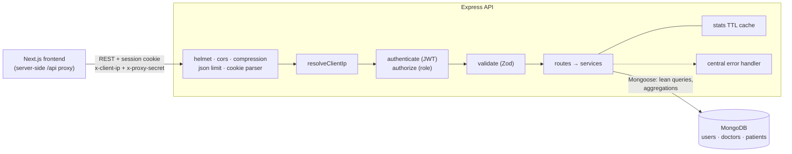
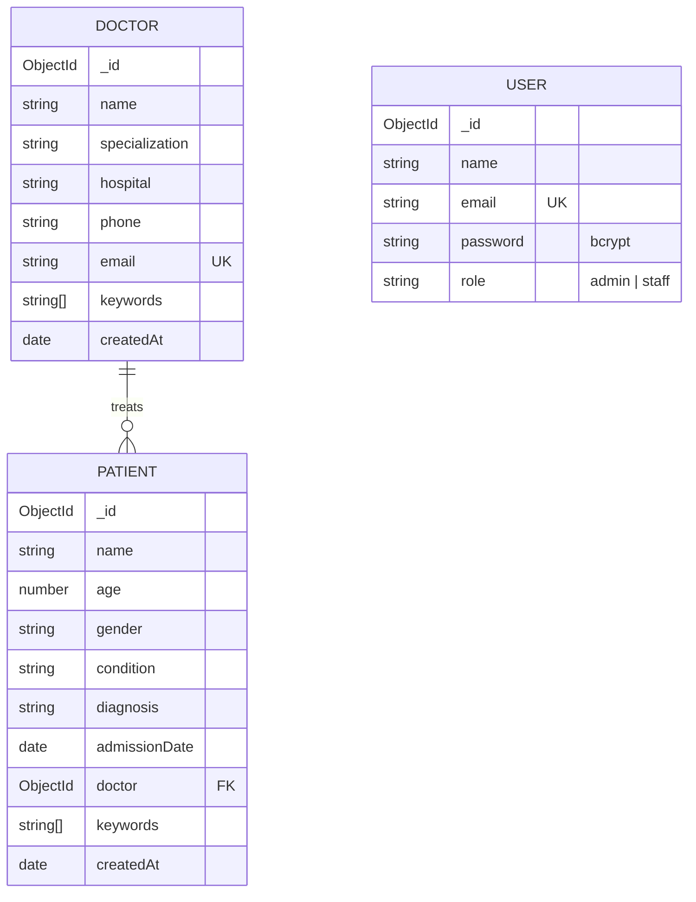

# Doctor Tracker: Backend API

> REST API for the Doctor Tracker admin portal. Express, TypeScript and MongoDB, with authentication, validation and query-optimised search, filtering, pagination and analytics.

## Description

The **Doctor Tracker API** is the backend for a hospital admin portal. It stores doctors and their patients in MongoDB and exposes a secure REST API for the **[Next.js frontend](https://github.com/saiful199324/doctor-tracker-frontend)**. Features:

- Session authentication with role-based permissions.
- Validated, injection-safe input.
- Index-backed search, filters and pagination over hundreds of thousands of records.
- Dashboard aggregations: admission trends, condition breakdowns, patients per doctor, demographics.

Every list query is served by a purpose-built compound index, verified with the MongoDB profiler on 100,000 patients.

## Links

| | |
| --- | --- |
| **Live API** | **https://doctor-tracker-api-4x90.onrender.com** (service info) · [`/api/health`](https://doctor-tracker-api-4x90.onrender.com/api/health) |
| **Live frontend** | **https://doctor-tracker-frontend-two.vercel.app** |
| **Frontend repository** | https://github.com/saiful199324/doctor-tracker-frontend |
| **Demo logins** | Admin `admin@doctortracker.dev` / `Admin@12345` · Staff `staff@doctortracker.dev` / `Staff@12345` |

Every route except `/`, `/api`, `/api/health` and `/api/auth/*` requires a session. The easiest way to use the live API is through the frontend. To call it directly, sign in first and keep the cookie:

```bash
curl -c cookie.txt -X POST https://doctor-tracker-api-4x90.onrender.com/api/auth/login \
  -H 'Content-Type: application/json' \
  -d '{"email":"admin@doctortracker.dev","password":"Admin@12345"}'
curl -b cookie.txt "https://doctor-tracker-api-4x90.onrender.com/api/doctors?search=card&limit=5"
```

> Hosted on Render's free plan. If the service has been idle, the first request can take up to a minute while it wakes up.

---

## Table of contents

1. [Tech stack](#tech-stack)
2. [Setup guide](#setup-guide)
3. [System architecture](#system-architecture)
4. [Technical decisions](#technical-decisions)
5. [Performance & indexing](#performance--indexing)
6. [API reference](#api-reference)
7. [Security](#security)
8. [Project structure](#project-structure)
9. [Deployment](#deployment)
10. [Scalability considerations](#scalability-considerations)

## Tech stack

| Concern | Choice |
| --- | --- |
| Runtime / framework | Node.js 20, Express 4, TypeScript |
| Database | MongoDB 7 (Atlas in production) with Mongoose 9 |
| Validation | Zod (body, query and params; unknown keys stripped) |
| Auth | JWT in an `httpOnly`, `Secure`, `SameSite=Lax` cookie; bcrypt (cost 12) |
| Hardening | Helmet, express-rate-limit, CORS allow-list, 100 KB body limit |

---

## Setup guide

### Prerequisites

- **Node.js 20+** and npm
- **MongoDB 6+**: Docker (a `docker-compose.yml` is included) or a local/Atlas instance

### 1. Clone and install

```bash
git clone https://github.com/saiful199324/doctor-tracker-backend.git
cd doctor-tracker-backend
npm install
```

### 2. Configure environment

```bash
cp .env.example .env
```

| Variable | Purpose |
| --- | --- |
| `PORT` | API port (default `4000`) |
| `MONGODB_URI` | Mongo connection string |
| `JWT_SECRET` | ≥ 32 random characters (`openssl rand -hex 32`). **Must match the frontend's `JWT_SECRET`.** |
| `JWT_EXPIRES_IN` | Session length, e.g. `1d` |
| `CLIENT_ORIGIN` | Allowed browser origin(s) for CORS (the frontend URL) |
| `TRUST_PROXY` | Proxies to trust for the visitor IP: a hop count (`1`) or subnet names (`loopback, linklocal, uniquelocal`) |
| `CLIENT_IP_HEADER` | Optional edge header holding the visitor IP (Render/Cloudflare: `cf-connecting-ip`) |
| `PROXY_SECRET` | Optional, ≥ 16 chars, **same value as the frontend's**. Lets the frontend proxy forward visitor IPs. |
| `SEED_*` | Credentials created by the seed script |

The example values work as-is locally. The server validates its environment on boot and exits with a clear message if anything is missing or invalid.

### 3. Start MongoDB

```bash
docker compose up -d     # mongodb://127.0.0.1:27017
```

### 4. Seed demo data and indexes

```bash
npm run seed             # 2 users, 60 doctors, 3,000 patients over ~14 months; builds indexes
npm run seed -- --doctors=200 --patients=100000   # large dataset for performance testing
npm run db:indexes       # index migration on its own: build missing, drop obsolete
```

### 5. Run

```bash
npm run dev              # http://localhost:4000 with hot reload
npm run build && npm start   # production build
```

Then start the [frontend](https://github.com/saiful199324/doctor-tracker-frontend) with `API_URL=http://localhost:4000`.

---

## System architecture



**Request lifecycle**

1. **Security middleware.** Helmet headers, a CORS allow-list, gzip, a 100 KB JSON body limit, and cookie parsing.
2. **Client IP.** `resolveClientIp` sets `req.ip` to the visitor's real address. It uses the frontend proxy's `x-client-ip` only when the matching `x-proxy-secret` is present. Otherwise it falls back to the edge header (`cf-connecting-ip`), then Express's `trust proxy`. The login rate limiter and the logs both use it.
3. **Authentication.** `authenticate` verifies the HS256 JWT from the `dt_token` cookie (or a Bearer header). `authorize('admin')` guards destructive routes.
4. **Validation.** `validate()` parses `params`, `query` and `body` with Zod, coercing types and stripping unknown keys.
5. **Service layer** → MongoDB, with `lean()` reads and index-backed queries.
6. **Errors** flow into one handler with a consistent shape: `{ success: false, message, errors?: { field: [msg] } }`. Stack traces are only included outside production.

**Data model**



Patients **reference** their doctor rather than being embedded. A doctor can have an unbounded number of patients, patients are queried on their own, and a patient can be reassigned.

---

## Technical decisions

### 1. Index-backed prefix search with a `keywords` array, instead of `$regex` "contains" or `$text`

**Problem.** Search must feel instant and match partial input. `smi` should find *John Smith*, and `card` should find every cardiologist.

| Option | Partial matches? | Uses an index? | Verdict |
| --- | --- | --- | --- |
| `{ name: /smi/i }` | ✅ | ❌ full collection scan | Slows down linearly with data |
| `$text` index | ❌ whole words only | ✅ | Bad search-as-you-type UX |
| Atlas Search | ✅ | ✅ | Ties the app to Atlas; overkill here |
| **`keywords` array + anchored regex** | ✅ word prefix | ✅ index range scan | **Chosen** |

**How it works** (`src/utils/search.ts`). Each write stores `keywords`: the lower-cased words of the searchable fields, plus a digits-only phone number. A multikey index `{ keywords: 1 }` covers the array. Each query word must prefix-match a keyword: `{ $and: [{ keywords: /^john/ }, { keywords: /^card/ }] }`. A **case-sensitive, left-anchored** regex is the one regex form MongoDB can answer with an index range scan, which is why the tokens are stored pre-lower-cased. Input is regex-escaped and capped at 5 terms and 100 characters.

**Result.** At 100,000 patients, a search page reads a few hundred documents and takes 2–4 ms. **Trade-off:** it matches word prefixes, not mid-word substrings, which suits how people search for names.

### 2. ESR compound indexes ending in a unique tiebreaker, verified with the profiler

**Problem.** Every list combines filters, a sort and pagination. An index that serves only the filter forces MongoDB to read *every* match and sort it in memory before it can return 10 rows.

**Decision.** Every index follows **Equality → Sort → Range**. Every sort ends in `_id`, a unique tiebreaker, so pages never overlap when values collide. The index for that sort ends with the same key, so MongoDB walks the index in order and **stops after one page**. Unfiltered counts use `estimatedDocumentCount()` (collection metadata) instead of scanning. `npm run db:indexes` is the migration step, since `autoIndex` is off in production.

**Verified with the MongoDB profiler on 100,000 patients** across 30 search, filter, sort and page combinations:

| Query | Records read: before → after |
| --- | --- |
| Sort patients by name | 100,000 (in-memory sort) → **10** |
| A doctor's patient list | 342 (in-memory sort) → **10** |
| Condition filter | 122 → **10** |
| Unfiltered list total | full collection scan → **O(1) metadata** |

**Other decisions in brief:**
- **Patient counts via aggregation, not a counter.** The doctor list counts patients for only the doctors on the page, with one `$match: { doctor: { $in: ids } } → $group`. It's always correct, with no drift.
- **Doctor deletion is blocked while patients exist** (409), instead of a silent cascade.
- **Zod strips unknown keys**, which blocks NoSQL operator injection (`{"$gt": ""}`) and mass assignment (`isAdmin`, `createdAt`).

---

## Performance & indexing

| Collection | Index | Serves |
| --- | --- | --- |
| doctors | `{ email: 1 }` unique | uniqueness |
| doctors | `{ createdAt: -1, _id: -1 }` | default sort + "joined" date range |
| doctors | `{ specialization: 1, createdAt: -1, _id: -1 }` | specialization filter + sort |
| doctors | `{ hospital: 1, createdAt: -1, _id: -1 }` | hospital filter + sort, `distinct('hospital')` |
| doctors | `{ name: 1, _id: 1 }` | A–Z / Z–A sort |
| doctors | `{ keywords: 1 }` | search |
| patients | `{ createdAt: -1, _id: -1 }` | default "recently added" sort |
| patients | `{ doctor: 1, createdAt: -1, _id: -1 }` | a doctor's patient list |
| patients | `{ condition: 1, createdAt: -1, _id: -1 }` | condition filter + sort |
| patients | `{ admissionDate: -1, _id: -1 }` | "recently admitted" sort, date range, timeline |
| patients | `{ doctor: 1, admissionDate: -1, _id: -1 }` | patients-per-doctor aggregation |
| patients | `{ condition: 1, admissionDate: -1, _id: -1 }` | condition + admission sort, condition chart |
| patients | `{ gender: 1, admissionDate: -1 }` | gender filter |
| patients | `{ name: 1, _id: 1 }`, `{ age: 1, _id: 1 }` | name and age sorts, age-group filter |
| patients | `{ keywords: 1 }` | search |

**Query patterns.** `lean()` on reads. Page and count run in parallel. One batched `populate` per page, selecting only the needed fields. The dashboard runs 14 independent queries concurrently, groups on indexed fields *before* any `$lookup`, buckets time series with `$dateTrunc` in the **viewer's timezone**, and caches results for 30 s (invalidated on every write).

**Measured at 100,000 patients:** lists under 35 ms, and the dashboard 0.08–0.27 s on first load and about 2 ms cached.

One known trade-off: an admission-date range combined with the "recently added" sort filters on one field and sorts on another, so it sorts its matches in memory (about 25 ms for a two-week range). The "recently admitted" sort is fully index-served.

---

## API reference

All routes are prefixed with `/api`.

| Method | Route | Role | Description |
| --- | --- | --- | --- |
| `GET` | `/`, `/api` | public | Service info |
| `GET` | `/health` | public | Liveness + DB status |
| `POST` | `/auth/login` | public | Sign in; sets the `dt_token` cookie. 10 failed attempts per 15 min per IP. |
| `POST` | `/auth/logout` | public | Clears the cookie |
| `GET` | `/auth/me` | any | Current user |
| `GET` | `/doctors` | any | List. Query: `page, limit, search, specialization, hospital, from, to, sort` |
| `GET` | `/doctors/options` | any | Doctor / hospital / specialization lists for dropdowns |
| `POST` | `/doctors` | any | Create a doctor |
| `GET` | `/doctors/:id` | any | Doctor + patient count + condition breakdown |
| `PATCH` | `/doctors/:id` | any | Update a doctor |
| `DELETE` | `/doctors/:id` | admin | Delete (409 while the doctor has patients) |
| `GET` | `/doctors/:id/patients` | any | That doctor's patients (same query parameters as `/patients`) |
| `POST` | `/doctors/:id/patients` | any | Add a patient under the doctor |
| `DELETE` | `/doctors/:id/patients/:patientId` | admin | Remove a patient from the doctor's list |
| `GET` | `/patients` | any | List. Query: `page, limit, search, condition, gender, doctor, ageMin, ageMax, from, to, sort` |
| `POST` | `/patients` | any | Create a patient (body includes `doctor`) |
| `GET` | `/patients/:id` | any | Single patient |
| `PATCH` | `/patients/:id` | any | Partial update; empty optional fields are removed |
| `DELETE` | `/patients/:id` | admin | Delete |
| `GET` | `/stats/overview` | any | Dashboard aggregates. Query: `range=7d\|30d\|90d\|12m`, `tz=<IANA zone>` |

**List response**

```json
{
  "success": true,
  "data": [{ "_id": "…", "name": "Dr. Jenna Howe", "patientCount": 13 }],
  "meta": { "page": 1, "limit": 10, "total": 60, "totalPages": 6, "hasNextPage": true, "hasPrevPage": false }
}
```

**Error response** (400 / 401 / 403 / 404 / 409 / 413 / 500)

```json
{ "success": false, "message": "Validation failed", "errors": { "email": ["Enter a valid email"] } }
```

---

## Security

- **Sessions.** A JWT signed with HS256 (algorithm pinned on verify), stored in an `httpOnly`, `Secure` (production), `SameSite=Lax` cookie. JavaScript can never read it.
- **Passwords.** bcrypt with cost 12. Unknown emails take as long as wrong passwords, so accounts can't be discovered by timing.
- **Authorization.** Only `admin` may delete; enforced on the server.
- **Input.** Zod on every route. Unknown keys are stripped (blocking injection and mass assignment), with size limits on strings, pages and bodies.
- **Rate limiting.** 10 failed logins per 15 minutes per real visitor IP. That IP is resolved through Cloudflare and the frontend proxy, and the proxy's forwarded IP is only trusted with the shared secret.
- **Errors.** No stack traces in production. Body-parser errors map to 400 / 413.

## Project structure

```
src/
├── index.ts               # bootstrap + graceful shutdown
├── app.ts                 # middleware pipeline + route mounting
├── config/                # env (Zod-validated), db connection
├── middleware/            # auth, client-ip, validate, error
├── models/                # User, Doctor, Patient (+ indexes)
├── modules/               # feature modules: routes → schema → service
│   ├── auth/  ├── doctors/  ├── patients/  └── stats/
├── utils/                 # ApiError, asyncHandler, search, pagination, cache, schemas
└── scripts/               # seed.ts, sync-indexes.ts (index migration)
```

## Deployment

Deployed on **Render** (free web service, Singapore) with **MongoDB Atlas** (free M0 cluster, AWS Singapore), as defined in [`render.yaml`](render.yaml). It redeploys on every push to `main`.

- **Build:** `npm ci --include=dev && npm run build`. **Start:** `npm start`. **Health check:** `/api/health`.
- **Environment:** `NODE_ENV=production`, `MONGODB_URI`, `JWT_SECRET` and `PROXY_SECRET` (both shared with the frontend), `CLIENT_ORIGIN` (the frontend URL), `TRUST_PROXY`, `CLIENT_IP_HEADER=cf-connecting-ip`.
- **Database:** a dedicated user with `readWrite` on `doctor_tracker` only. Data was loaded with `npm run seed`.
- **Keep-awake:** [`.github/workflows/keep-api-warm.yml`](.github/workflows/keep-api-warm.yml) pings `/api/health` every 10 minutes from 08:00 to 23:00 Bangladesh time. The URL comes from the repository variable `API_HEALTH_URL`. It doesn't run 24/7 because free instance hours are shared across the workspace.

## Scalability considerations

- **Stateless API.** JWT sessions let any number of instances run behind a load balancer. The only in-process state is the 30 s dashboard cache, whose small interface could be backed by Redis.
- **Deep pagination.** Offset paging suits page-number UX. The `(createdAt, _id)` / `(admissionDate, _id)` indexes already support switching to cursor (keyset) pagination.
- **Counts at scale.** Filtered `countDocuments` is index-backed but O(matches). At millions of rows, cap counts ("10,000+") or cache them per filter.
- **Analytics at scale.** Move to pre-aggregated daily rollups (a scheduled `$merge` into `daily_stats`) or read from a secondary.
- **Search.** For typo tolerance or relevance ranking, move to Atlas Search behind the same `search` parameter.
- **Operations.** Graceful shutdown, a health endpoint, validated configuration, structured errors and request logging.
